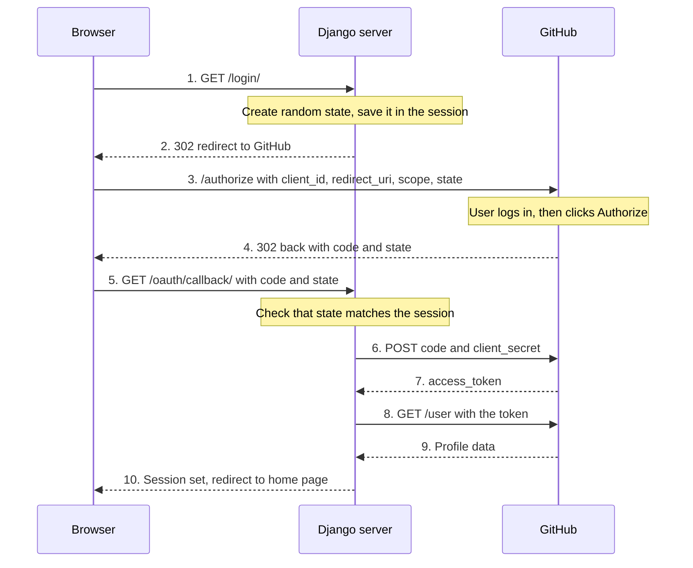
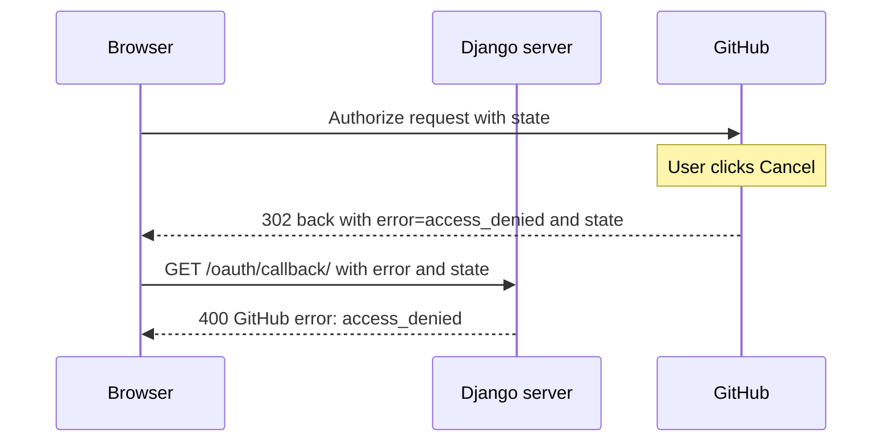
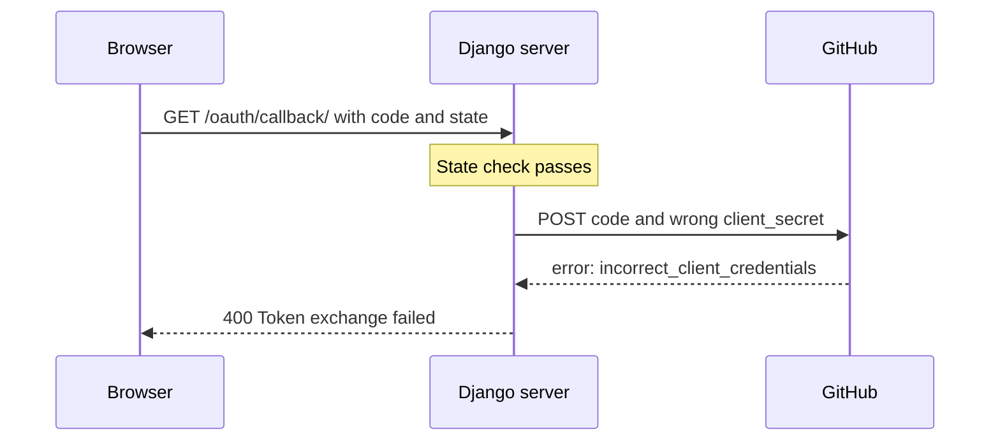

# Django GitHub OAuth demo

A minimal example of the OAuth 2.0 **Authorization Code flow** in plain Django, with no OAuth library. Users log in with their GitHub account, and the code shows each step of the flow so it is easy to follow.

## What it does

- Sends the user to GitHub to log in and approve access
- Receives GitHub's response on a callback URL
- Exchanges the temporary code for an access token (server to server)
- Fetches the user's GitHub profile and stores it in the Django session
- Shows a greeting with the user's name and avatar, and supports logout

The app asks for the `read:user` scope only, which is read-only access to the user's profile.

## How the flow works



Steps 3 and 4 pass through the browser. Steps 6 to 9 are direct server-to-server calls that the browser never sees.

| Step | What happens |
|---|---|
| 1-2 | `login_view` generates a random `state`, stores it in the session, and redirects the browser to GitHub. |
| 3 | GitHub checks that the `client_id` is registered and that the `redirect_uri` matches the registered callback URL. |
| Login and Authorize | The user authenticates on GitHub (password) and then authorizes (consent to the requested scope). Django never sees the password. |
| 4-5 | GitHub redirects back with a one-time `code` and the original `state`. `callback_view` verifies the `state`. |
| 6-7 | Django sends the `code` together with the `client_secret` to GitHub and receives an access token. |
| 8-9 | Django calls the GitHub API with the token and gets the user's profile. |
| 10 | Django saves minimal profile info in the session, which is what makes the user logged in to this app. |

### Who issues which credential

| Credential | Issued by | Issued to | Purpose |
|---|---|---|---|
| `client_id` and `client_secret` | GitHub | The developer, when registering the app | Identify the app and prove it is the real one |
| `code` | GitHub | The browser, after the user approves | One-time ticket, useless without the secret |
| `access_token` | GitHub | The Django server, in exchange for code and secret | Permission to call the API within the approved scope |

## Scenarios

### 1. The user cancels the authorization

If the user clicks **Cancel** on GitHub's consent screen, GitHub still redirects back to the callback URL, but the response is different:

```
/oauth/callback/?error=access_denied&error_description=...&state=<same state as before>
```

- The `state` is **not** different. It is always the value Django sent, whether the user approves or denies. It only proves that the response belongs to a login this app started.
- The denial is signaled by the `error` parameter, and there is **no `code`**.
- Django returns a 400 response, no token is requested, and no session is created.



The relevant code in `callback_view`:

```python
if request.GET.get("error"):
    return HttpResponseBadRequest(f"GitHub error: {request.GET['error']}")
```

Even without this check, the later `if not code` check would stop the flow, because a denied request never carries a code.

### 2. Django does not have the client secret

The user can approve the request and still fail to log in if the app cannot prove who it is. There are two variants.

**a) The secret is missing from the environment.** `settings.py` reads it with `os.environ["GITHUB_CLIENT_SECRET"]`, so Django crashes at startup with a `KeyError` that names the missing variable. The server never runs, so no login can even begin.

**b) The secret is present but wrong.** The flow reaches step 6, and GitHub refuses to issue a token:

```json
{
  "error": "incorrect_client_credentials",
  "error_description": "The client_id and/or client_secret passed are incorrect."
}
```



The relevant code in `callback_view`:

```python
access_token = data.get("access_token")
if not access_token:
    return HttpResponseBadRequest(f"Token exchange failed: {data}")
```

No session is created, so the user is not logged in.

**Why the secret matters.** The `code` travels through the browser (address bar, history, logs), so it could leak. On its own it is useless: GitHub only turns it into a token when the request also carries the `client_secret`, which lives only on the server. Stealing the code does not let an attacker obtain a token.

## Setup (Windows)

### 1. Register an OAuth app on GitHub

Go to **Settings, Developer settings, OAuth Apps, New OAuth App** and enter:

- Homepage URL: `http://127.0.0.1:8000/`
- Authorization callback URL: `http://127.0.0.1:8000/oauth/callback/`

Copy the **Client ID** and generate a **Client Secret**.

### 2. Install

```powershell
python -m venv venv
venv\Scripts\Activate.ps1
pip install -r requirements.txt
```

### 3. Configure

Copy `.env.example` to `.env` and fill in your values:

```
GITHUB_CLIENT_ID=your_client_id_here
GITHUB_CLIENT_SECRET=your_client_secret_here
GITHUB_REDIRECT_URI=http://127.0.0.1:8000/oauth/callback/
```

The callback URL must match the one registered on GitHub exactly, including the trailing slash.

### 4. Run

```powershell
python manage.py migrate
python manage.py runserver
```

Open `http://127.0.0.1:8000/` and click **Login with GitHub**.

## Project structure

```
oauth_demo/
├── manage.py
├── config/            # Django settings and root URLs
├── accounts/
│   ├── views.py       # home, login_view, callback_view, logout_view
│   └── urls.py
├── .env               # real credentials (not committed)
├── .env.example       # template for .env
├── requirements.txt
└── .gitignore
```

## Security notes

- Never commit `.env`. It holds the client secret, and `.gitignore` excludes it. If it is ever committed by accident, regenerate the secret in the GitHub OAuth app settings.
- The `state` value is generated with Python's `secrets` module, stored in the session, and removed once checked, so each value can be used only once.
- The access token is used once and is not stored.
- User-supplied values (such as the GitHub display name) are escaped before being rendered in HTML.
- This demo runs over plain HTTP on localhost. Use HTTPS in any real deployment.

## Not covered

- Creating a real Django `User` for each GitHub account
- PKCE
- Refresh tokens
- OpenID Connect
